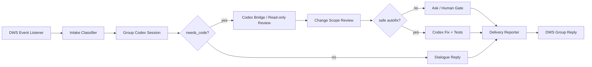
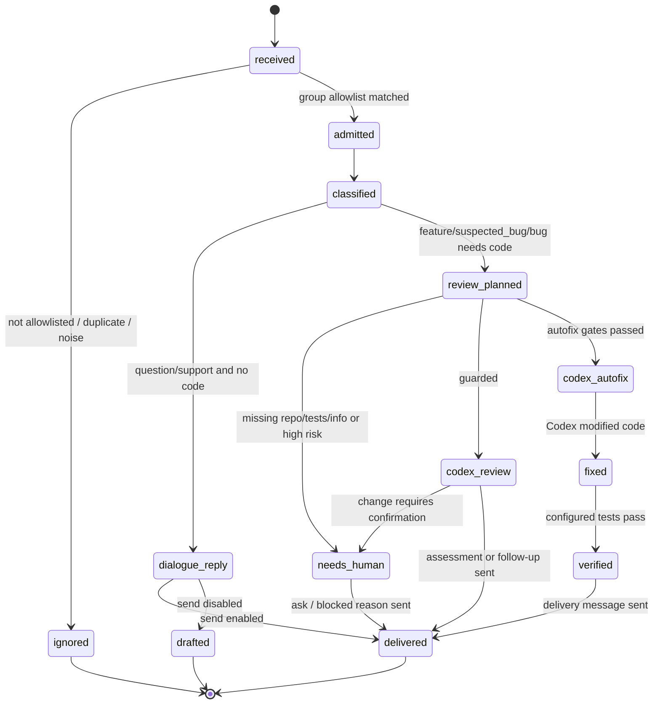

# CodeX Avatar 产品经理型个人代理 Spec

## 1. 目标

构建一个和 Codex 连接的钉钉个人代理，也就是 CodeX Avatar。它持续监听白名单项目群，读取用户反馈，先做产品经理式分流，再决定是直接对话回复、追问补充信息、进入需求评审，还是交给 Codex 做代码评估、修复、测试和交付回群。

它不是普通自动回复机器人，也不是监听到消息就改代码的脚本。所有外部消息、代码动作、测试证据和交付回复都必须被状态机记录，并且受白名单、模式、风险和验证门禁控制。

核心场景：

- 监听多个项目群：抓虾、Listingify、深绘 AI 上新等。
- 读到反馈后分类：咨询、操作问题、需求、疑似 BUG、明确 BUG、运维/权限/发布、噪声。
- 能通过对话解决的，直接在群里回复。
- 需要代码判断的，自动进入 Codex 评审/实现流程。
- Codex 先评估改动面，必要时回群追问或转人工确认。
- 确认是 BUG 且风险可控时，自动修改、跑测试、输出证据。
- 完成后回群交付：修了什么、验证了什么、是否已发布或待发布。

## 2. 总体架构



### 2.1 DWS Event Listener

事实来源只使用 DWS 个人 IM 事件长连接，不轮询历史消息：

```bash
dws event consume user_im_message_receive_group \
  --group <openConversationId> \
  --flatten \
  -f ndjson
```

监听规则：

- 配置里一个启用群对应一个 `dws event consume` 子进程。
- 每个子进程只订阅一个 `openConversationId`。
- 启动后等待 stderr 中的 `[event] ready ...`，再认定监听可用。
- 即使 DWS 已按 `--group` 过滤，worker 仍会再次检查事件里的 `conversation_id` 是否在准入集合里。
- 非白名单群消息在任何 AI 调用、Codex 调用和回复发送前丢弃。
- 每条事件通过 `event_id` / `message_id` / 内容哈希做本地去重。

### 2.2 Intake Classifier

分类器把群消息归一为结构化反馈：

```json
{
  "project": "crawshrimp|listingify|deepdraw|winyai",
  "type": "question|support|feature|suspected_bug|bug|ops|noise",
  "confidence": 0.87,
  "needs_code": true,
  "risk": "low|medium|high",
  "reply_draft": "收到，按 BUG 反馈进入排查，我会先评估改动面和验证路径。",
  "codex_task": {
    "repo": "/Users/xingyicheng/Documents/crawshrimp",
    "goal": "复现并修复用户反馈的明确 BUG，完成测试并给出交付说明。",
    "evidence": [
      "ding_event:<event_id>",
      "ding_message:<message_id>",
      "ding_conversation:<openConversationId>"
    ],
    "acceptance": [
      "确认根因",
      "实现低风险修复",
      "运行配置的测试命令",
      "输出交付说明和待发布状态"
    ],
    "test_commands": ["python3 -m pytest"]
  }
}
```

分类语义：

| 中文类型 | `type` | 默认动作 |
|---|---|---|
| 咨询 | `question` | 直接对话回复 |
| 操作问题 | `support` | 直接给操作路径；必要时追问 |
| 需求 | `feature` | 进入需求评审，默认不自动改代码 |
| 疑似 BUG | `suspected_bug` | 先复现/定位；信息不足则追问 |
| 明确 BUG | `bug` | 评估改动面；低风险可自动修复 |
| 运维/权限/发布 | `ops` | 高风险优先，转人工确认 |
| 噪声 | `noise` | 不回复、不进 Codex |

### 2.3 Codex Bridge

每个群可以配置 `reply_engine=codex`。启用后，worker 会为每个群维护一个长期 Codex session；普通回复、追问、进度回答和允许范围内的本地只读探查都通过这个 session 完成。DWS 只负责监听和发送，回复正文由 Codex session 输出。

Codex session 状态：

```text
~/.dws/ai-autoreply/codex-sessions/<conversation_id>/
  session.json
  <event_id>.prompt.md
  <event_id>.codex.jsonl
  <event_id>.codex.err.log
  last_message.md
```

当 `needs_code=true` 且需要单独评审记录时，worker 也会生成 Codex task bundle：

```text
~/.dws/ai-autoreply/codex-tasks/<task_id>/
  event.json
  classification.json
  prompt.md
  codex.jsonl
  codex.err.log
  last_message.md
  status.json
```

Codex Bridge 的职责：

- 把群消息、项目、仓库路径、分类结果、验收标准和测试命令写入 task bundle。
- 在 `guarded` 模式下，用 `codex exec --sandbox read-only` 做评审，不允许改文件。
- 在 `autofix` 模式下，只有通过门禁才用 `codex exec --sandbox workspace-write`。
- Codex prompt 强制先输出改动面评估，再决定 `NEEDS_INFO`、`BLOCKED` 或 `FIXED`。
- 监听进程本身不直接编辑项目仓库；代码动作只发生在 Codex 子任务中。

### 2.4 Delivery Reporter

Delivery Reporter 把状态机结果转成群里能理解的话：

- 已收到，正在判断。
- 这个需要补充信息：缺少复现步骤/截图/账号环境/具体商品。
- 已进入 Codex 评审，正在评估改动面和验证路径。
- 已确认为 BUG，开始修复。
- 已修复，验证通过：列出测试命令和结果。
- 已本地完成，待发布/待合并。
- 无法自动处理：说明风险、缺少 repo、缺少测试命令或需要人工确认。

交付消息不能声称已发布，除非有真实发布或读回证据。

## 3. 状态机



不变量：

- `received -> admitted` 必须命中群白名单。
- `classified -> dialogue_reply` 必须满足 `needs_code=false`。
- `review_planned -> codex_autofix` 必须满足低风险、明确 BUG、高置信、repo 可用、测试命令存在、显式开启 `codex_execute`。
- `fixed -> verified` 必须有当前轮测试证据。
- `verified -> delivered` 不能把“本地已修复”说成“线上已发布”。

## 4. 自动化模式

| 模式 | 读群 | 分类 | 发普通对话 | 创建 Codex task bundle | 启动 Codex | 改代码 |
|---|---:|---:|---:|---:|---:|---:|
| `observe` | yes | yes | no | no | no | no |
| `draft` | yes | yes | no | yes, only draft | no | no |
| `guarded` | yes | yes | yes, if `send=true` | yes | yes, review-only | no |
| `autofix` | yes | yes | yes, if `send=true` | yes | yes | only gated low-risk BUG |

默认模式是 `draft`。历史兼容的 `send` 会被视为 `guarded + send=true`。

## 5. 自动修复门禁

真正自动改代码必须同时满足：

- 群已白名单。
- 项目已配置 `project` 和 `repo`。
- `mode=autofix`。
- `codex_execute=true`。
- 分类为 `bug`，不是 `feature` 或 `suspected_bug`。
- 分类置信度大于等于 `autofix_min_confidence`，默认 `0.85`。
- `risk=low`。
- repo 路径存在且可访问。
- 至少配置一条测试命令。
- 消息不涉及权限、支付、生产配置、数据删除、发布开关、凭证等高风险动作。

任一条件不满足，则转为 `blocked` 或 `needs_human`，只回群说明需要补充信息或人工确认。

## 6. 配置契约

运行配置默认放在 git 外：

```text
~/.dws/ai-autoreply/config.json
```

完整示例：

```json
{
  "defaults": {
    "mode": "draft",
    "profile": "",
    "query": "问题,反馈,bug,报错,不能用,需求",
    "reply_target": "auto",
    "ready_message": "",
    "send": false,
    "reply_engine": "codex",
    "classifier": "heuristic",
    "codex_execute": false
  },
  "groups": [
    {
      "name": "赢在AI",
      "group": "<openConversationId>",
      "project": "winyai",
      "repo": "",
      "mode": "draft",
      "ready_message": "我在了",
      "enabled": true
    },
    {
      "name": "抓虾反馈群",
      "group": "<openConversationId>",
      "project": "crawshrimp",
      "repo": "/Users/xingyicheng/Documents/crawshrimp",
      "mode": "guarded",
      "reply_engine": "codex",
      "code_keywords": ["抓虾", "crawshrimp"],
      "query": "抓虾,AI视频,生图,鞋包,报错,不能用,需求",
      "test_commands": ["python3 -m pytest"],
      "enabled": true
    },
    {
      "name": "Listingify / SHEIN API 测试群",
      "group": "<openConversationId>",
      "project": "listingify",
      "repo": "/Users/xingyicheng/Documents/Listingify",
      "mode": "guarded",
      "query": "SHEIN,上新,草稿,发布,类目,尺码,报错,需求",
      "test_commands": ["npm test"],
      "enabled": true
    },
    {
      "name": "深绘 AI 上新反馈群",
      "group": "<openConversationId>",
      "project": "deepdraw",
      "repo": "/Users/xingyicheng/Documents/Listingify",
      "mode": "guarded",
      "query": "深绘,AI上新,建档,尺码表,图片,类目,报错,需求",
      "test_commands": ["npm test"],
      "enabled": true
    }
  ]
}
```

配置检查：

```bash
codex-avatar \
  --config ~/.dws/ai-autoreply/config.json \
  --config-check
```

启动监听：

```bash
codex-avatar \
  --config ~/.dws/ai-autoreply/config.json \
  --print-command
```

## 7. DWS 命令边界

监听只用：

```bash
dws event consume user_im_message_receive_group --group <cid> --flatten -f ndjson
```

回复只用：

```bash
dws chat message send \
  --group <cid> \
  --text "<message>" \
  --uuid "<stable uuid>" \
  --format json
```

所有 DWS 命令必须带 `--format json` 或事件流 `-f ndjson`。禁止通过 curl、浏览器、未验证 API 或消息历史轮询替代 DWS 事件长连接。

## 8. Codex 子任务契约

Codex prompt 必须包含：

- 原始群消息。
- 项目和 repo。
- 分类 JSON。
- 群消息证据引用。
- 验收标准。
- 测试命令。
- 当前自动化模式。
- 明确的高风险停止规则。

Codex 输出约定：

- `NEEDS_INFO:` 信息不足，需要回群追问。
- `BLOCKED:` 风险、权限、测试路径或 repo 缺口导致无法自动处理。
- `FIXED:` 已修复并验证；必须说明改了什么、跑了哪些测试、发布状态。

在 `guarded` 模式下，Codex 只能评审和定位，不能修改文件。在 `autofix` 模式下，Codex 仍必须先评估改动面；如果评估后风险升高，必须停止。

## 9. 交付话术模板

收到类：

```text
收到，按 BUG 反馈进入排查，我会先评估改动面和验证路径。
```

追问类：

```text
这个需要补充信息：请发一下复现步骤、截图和发生问题的商品/任务编号。
```

需求评审类：

```text
已进入需求评审。我先评估影响模块、验收标准和是否需要排期；不会直接改线上逻辑。
```

修复完成类：

```text
已完成本地修复：修了 <summary>。验证：<commands/results>。当前状态：待发布/待合并。
```

阻断类：

```text
这条不能自动处理：涉及 <risk/reason>，需要人工确认后继续。
```

## 10. 可观测性和审计

worker stdout 输出一行一个 JSON：

- `consume_command`
- `classified`
- `draft`
- `sent`
- `codex_draft`
- `codex_planned`
- `codex_blocked`
- `codex_completed`
- `codex_failed`
- `ready_message_sent`
- `skipped`

必须记录：

- `event_id`
- `message_id`
- `conversation_id`
- `project`
- `classification`
- `task_id`
- `task_dir`
- `send_result`

不得记录：

- token、验证码、密码、身份证、银行卡、支付凭证。
- 群内敏感附件原文。
- 生产配置密钥。

## 11. 验收标准

完整工作流验收：

- 能通过配置监听多个项目群。
- 非白名单群消息不会触发 AI、Codex 或回复。
- 咨询/操作问题能形成回复草稿或按配置发送。
- 需求/疑似 BUG/明确 BUG 能形成 Codex task bundle。
- `guarded` 只做 Codex 评审，不改文件。
- `autofix` 只在低风险明确 BUG 且测试命令存在时启动可写 Codex。
- 高风险、缺 repo、缺测试命令、信息不足会转人工确认。
- Codex 完成后能生成回群交付文案，区分本地完成、待发布、已发布。
- ready marker 场景中，第一期开白群 `赢在AI` 成功收到 `我在了`。

工程验收：

- `python3 -m py_compile src/codex_avatar/worker.py tests/test_worker.py`
- `python3 tests/test_worker.py`
- `codex-avatar --config config/example.json --config-check`
- `git diff --check`

## 12. Rollout

第一步连接验证：

- 查询并确认 `赢在AI` 的 `openConversationId`。
- 写入本地运行配置。
- 启动监听。
- 监听 ready 后在群里回复 `我在了`。

第二步多群 observe/draft：

- 加入抓虾、Listingify、深绘 AI 上新群配置。
- `mode=observe` 跑 1-2 天，校验分类日志。
- 切到 `mode=draft`，只产出回复和 Codex prompt，不发送。

第三步 guarded：

- 对咨询/操作问题允许 `send=true`。
- 代码类反馈进入 Codex read-only 评审。
- 需求和疑似 BUG 只输出追问、改动面和验收标准。

第四步 autofix：

- 只给低风险项目开启。
- 必须配置 repo 和测试命令。
- 只允许明确 BUG 自动修复。
- 修复后默认回群说明本地完成和待发布，不自动发布。

第五步发布/合并闭环：

- 发布、合并、打 tag、推送、生产配置变更仍是独立高风险动作。
- 只有当项目另行配置发布证据读取，并且获得明确授权，Delivery Reporter 才能说“已发布”。
